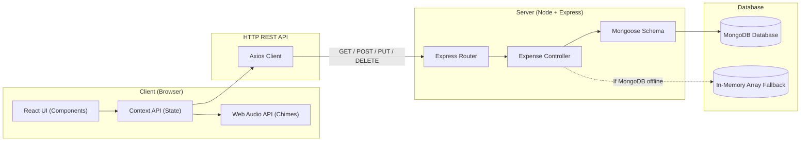

# 📚 Ledgerly — Complete Beginner-to-Pro Tech Stack & Architecture Guide

Welcome! If you are learning web development or preparing to present/explain this project for an interview, college viva, or team walkthrough, this guide breaks down every single technology used in **Ledgerly** into simple, friendly concepts with real-world analogies.

---

## 🧭 The 30-Second Big Picture

Ledgerly is a **full-stack web application** built with the **MERN Stack**:
- **M** — **MongoDB** (Database: where data lives permanently)
- **E** — **Express.js** (Backend Web Framework: creates API endpoints)
- **R** — **React.js** (Frontend: what users see and interact with)
- **N** — **Node.js** (JavaScript Runtime: runs JS on your computer/server)

### 🍽️ The Restaurant Analogy
To easily understand full-stack architecture:
| Component | Restaurant Analogy | In Ledgerly |
| :--- | :--- | :--- |
| **Frontend (React)** | **The Dining Room & Menu** | The glassmorphic UI where users type expenses, see charts, and click buttons. |
| **API Client (Axios)** | **The Waiter** | Carries orders (requests) from the table to the kitchen and brings back dishes (responses). |
| **Backend (Express + Node)**| **The Kitchen Chefs** | Receives orders, validates recipes (business logic), checks prices, prepares food. |
| **Database (MongoDB + Mongoose)** | **The Storage Pantry & Fridge** | Where raw ingredients and saved receipts are stored permanently in organized shelves. |



---

## 1. 🖥️ Frontend Architecture (Client-Side)

The frontend is located inside the [`frontend/`](file:///c:/Users/HP%20745%20G6/Downloads/New%20folder%20%282%29/frontend) directory. It is responsible for rendering the interface, managing user interactions, and communicating with the backend.

### A. React 19 ([`frontend/package.json`](file:///c:/Users/HP%20745%20G6/Downloads/New%20folder%20%282%29/frontend/package.json))
- **What is it?** A popular JavaScript library developed by Meta for building dynamic user interfaces.
- **Why do we use it?** Instead of manually manipulating HTML elements (`document.getElementById`), React allows us to build independent, reusable pieces called **Components** (like LEGO blocks).
- **Key Concepts Used**:
  1. **JSX (JavaScript XML)**: Lets you write HTML-like syntax directly inside JavaScript files (`App.jsx`, `ExpenseTable.jsx`).
  2. **React Hooks**:
     - `useState`: Stores component memory (e.g., is the modal open? what did the user type?).
     - `useEffect`: Runs side-effects like fetching data from the backend when the page loads.
     - `useContext`: Shares global data across all components without "prop drilling".
     - `useMemo` & `useCallback`: Performance optimizations that prevent slow re-calculations when filtering and sorting large lists of transactions.

### B. Vite 8 ([`frontend/vite.config.js`](file:///c:/Users/HP%20745%20G6/Downloads/New%20folder%20%282%29/frontend/vite.config.js))
- **What is it?** A modern, ultra-fast frontend build tool and development server created by Evan You (creator of Vue.js).
- **Why Vite instead of old `create-react-app` (Webpack)?**
  - Instant server startup (milliseconds vs tens of seconds).
  - **HMR (Hot Module Replacement)**: When you edit a React file and save, Vite updates *only that exact component* in the browser instantly without reloading the entire page.
  - Native ES Modules (`import`/`export`) supported directly by modern browsers.

### C. Tailwind CSS ([`frontend/tailwind.config.js`](file:///c:/Users/HP%20745%20G6/Downloads/New%20folder%20%282%29/frontend/tailwind.config.js))
- **What is it?** A utility-first CSS framework.
- **How it works:** Instead of writing custom CSS classes in `.css` files, you apply pre-made utility classes directly on HTML elements:
  ```jsx
  <div className="bg-white/75 backdrop-blur-xl rounded-2xl p-6 shadow-lg border border-slate-200">
  ```
- **Design Aesthetic (Glassmorphism)**:
  - Uses `backdrop-blur-xl` and semi-transparent backgrounds (`bg-white/70`, `bg-slate-900/70`) to create a frosted glass look.
  - Configured with custom emerald and indigo brand palettes, soft shadows, and responsive breakpoints (`sm:`, `md:`, `lg:`).

### D. Web Audio API Synthesizer ([`frontend/src/utils/soundEffects.js`](file:///c:/Users/HP%20745%20G6/Downloads/New%20folder%20%282%29/frontend/src/utils/soundEffects.js))
- **What is it?** A browser-native API that synthesizes sound waves dynamically using mathematical frequencies.
- **Why is this special?**
  - **Zero External Assets**: No heavy `.mp3` or `.wav` files need to be downloaded from the network.
  - **Zero Latency**: Sounds play instantaneously when you add, edit, or delete an item.
  - **How it works under the hood**:
    - Creates an `AudioContext`.
    - Spawns an `OscillatorNode` (generates wave frequencies like Sine, Triangle, Square).
    - Routes it through a `GainNode` (controls volume envelope: fade-in and exponential decay).
    - Plays a warm musical triad chord for additions (`C5` 523Hz $\to$ `E5` 659Hz $\to$ `G5` 784Hz $\to$ `C6` 1046Hz) and a gentle low-pass sweep for deletions.

### E. React Context API ([`frontend/src/context/ExpenseContext.jsx`](file:///c:/Users/HP%20745%20G6/Downloads/New%20folder%20%282%29/frontend/src/context/ExpenseContext.jsx))
- **What is it?** React's built-in state management solution.
- **Why we need it:** Without Context, if the `Navbar` needs to know total expenses, and `ExpenseTable` needs to edit an expense, and `SummaryCards` needs category totals, you would have to pass props down through 5 levels of parent-child components. Context acts as a **central broadcast tower** where any component can read or update expense state directly.

### F. Axios & Service Layer ([`frontend/src/services/api.js`](file:///c:/Users/HP%20745%20G6/Downloads/New%20folder%20%282%29/frontend/src/services/api.js))
- **What is it?** A promise-based HTTP client for browser and Node.js.
- **Features in this app**:
  - Pre-configured base URL (`http://localhost:5000/api`).
  - Request/Response interceptors for uniform error handling.
  - Automatic JSON serialization.

---

## 2. ⚙️ Backend Architecture (Server-Side)

The backend is located inside the [`backend/`](file:///c:/Users/HP%20745%20G6/Downloads/New%20folder%20%282%29/backend) directory. It exposes RESTful HTTP endpoints that the frontend calls.

### A. Node.js
- **What is it?** A runtime environment that executes JavaScript code outside of a web browser, powered by Chrome's V8 engine.
- **Why Node.js?** Allows using one single programming language (JavaScript) across both client and server. It uses an **event-driven, non-blocking I/O model**, making it lightweight and capable of handling thousands of concurrent requests.

### B. Express.js ([`backend/server.js`](file:///c:/Users/HP%20745%20G6/Downloads/New%20folder%20%282%29/backend/server.js))
- **What is it?** The de facto standard minimalist web framework for Node.js.
- **Key Responsibilities**:
  1. **Routing**: Directs incoming HTTP requests based on URL and Method:
     - `GET /api/expenses` $\to$ fetch list
     - `POST /api/expenses` $\to$ create expense
     - `PUT /api/expenses/:id` $\to$ update expense
     - `DELETE /api/expenses/:id` $\to$ delete expense
  2. **Middleware Pipeline**:
     - `cors`: Handles Cross-Origin Resource Sharing so browser security allows `localhost:5173` to query `localhost:5000`.
     - `express.json()`: Automatically parses JSON request bodies.
     - `morgan`: Logs HTTP requests in development console (`GET /api/expenses 200 4.2ms`).
     - `errorHandler`: Catches validation errors, invalid ObjectIds, or server crashes and returns clean JSON error responses.

### C. Architecture Pattern (MVC - Model, View, Controller)
The backend follows clean separation of concerns:
- **Routes** ([`backend/routes/expenseRoutes.js`](file:///c:/Users/HP%20745%20G6/Downloads/New%20folder%20%282%29/backend/routes/expenseRoutes.js)): Defines the URL endpoints.
- **Controllers** ([`backend/controllers/expenseController.js`](file:///c:/Users/HP%20745%20G6/Downloads/New%20folder%20%282%29/backend/controllers/expenseController.js)): Contains the business logic, calculations, filtering, and database operations.
- **Models** ([`backend/models/Expense.js`](file:///c:/Users/HP%20745%20G6/Downloads/New%20folder%20%282%29/backend/models/Expense.js)): Defines the database schema and validation rules.

---

## 3. 🗄️ Database Layer

### A. MongoDB
- **What is it?** A leading **NoSQL document database**.
- **Document vs Table**:
  - In traditional SQL (like MySQL), data is stored in strict rows and columns across multiple tables joined by foreign keys.
  - In MongoDB, each record is stored as a flexible, JSON-like **BSON document** (e.g. `{ description: "Groceries", amount: 4250, category: "Food & Dining" }`).

### B. Mongoose ODM ([`backend/models/Expense.js`](file:///c:/Users/HP%20745%20G6/Downloads/New%20folder%20%282%29/backend/models/Expense.js))
- **What is it?** An **ODM (Object Data Modeling)** library for MongoDB and Node.js.
- **What does it do for us?**
  1. **Schema Validation**: Enforces strict rules before anything gets saved:
     - `description`: String, required, 2–120 characters, trimmed.
     - `amount`: Number, required, must be $> 0$.
     - `category`: Must match an enum (`Food & Dining`, `Transportation`, `Investment`, etc.).
     - `paymentMethod`: Enum (`UPI / GPay`, `Credit Card`, `Net Banking`, etc.).
     - `date`: Valid timestamp.
  2. **Indexes**: Creates database indexes (`date: -1`, `category: 1`, text index on description) for high-speed queries.
  3. **Timestamps**: Automatically adds `createdAt` and `updatedAt`.

### C. Graceful In-Memory Storage Fallback ([`backend/config/db.js`](file:///c:/Users/HP%20745%20G6/Downloads/New%20folder%20%282%29/backend/config/db.js))
- A resilient design pattern: if MongoDB is running locally, it connects to MongoDB. If MongoDB is stopped, the backend automatically switches to an internal in-memory data store with demo seed data, so developers never get blocked by database connectivity.

---

## 4. 🇮🇳 Localization & Formatting

- **Indian Rupee (₹) Formatting** ([`frontend/src/utils/formatters.js`](file:///c:/Users/HP%20745%20G6/Downloads/New%20folder%20%282%29/frontend/src/utils/formatters.js)):
  - Built with `Intl.NumberFormat('en-IN', { style: 'currency', currency: 'INR' })`.
  - Formats numbers using standard Indian grouping:
    - ₹ 1,000 (Thousand)
    - ₹ 1,00,000 (One Lakh)
    - ₹ 1,00,00,000 (One Crore)

---

## 5. 🔄 Life of a Request (Step-by-Step Flow)

What happens when a user clicks **"Save Expense"**?

1. **User Action**: The user fills out the form in `ExpenseModal.jsx` and clicks **Submit**.
2. **Client Validation**: React verifies that amount is positive and description is non-empty.
3. **API Dispatch**: `expenseService.createExpense()` sends an HTTP `POST` request with JSON body to `http://localhost:5000/api/expenses`.
4. **Server Middleware**: Express parses the JSON body via `express.json()`.
5. **Controller Handling**: `createExpense` in `expenseController.js` receives `req.body`.
6. **Mongoose Validation**: Mongoose validates types and enums against `Expense.js`.
7. **Database Insert**: MongoDB persists the document and returns the newly generated `_id` and timestamps.
8. **Server Response**: Express sends `HTTP 201 Created` with the JSON record.
9. **State Update**: React Context receives the record, prepends it to the expense array, recalculates summary cards, and closes the modal.
10. **Acoustic Feedback**: Web Audio API triggers `playAddSuccessSound()` playing the rising musical chord!

---

## 6. 🎤 Interview & Viva Explanation Cheat Sheet

If an examiner, interviewer, or colleague asks you about this project, here are direct, professional answers:

### Q1: "Why did you choose the MERN stack for this project?"
> *"MERN allows full-stack JavaScript development, meaning both frontend and backend share the same language and data structures (JSON). React provides reactive UI rendering with component reusability, Express and Node offer high-concurrency non-blocking I/O, and MongoDB provides a flexible document schema naturally suited for JSON transaction logs."*

### Q2: "How is state managed in the frontend?"
> *"We use React Context API combined with custom hooks (`useExpenses`). This centralizes expense state, filtering params, pagination, and summary statistics in one place, avoiding prop drilling while keeping components modular and lightweight without needing bulky libraries like Redux."*

### Q3: "Why did you implement sound effects using Web Audio API instead of audio files?"
> *"Traditional audio tags (`<audio src='sound.mp3'>`) require downloading media files over the network, introducing bandwidth overhead and playback latency. Web Audio API synthesizes frequencies dynamically using oscillators directly in the browser's audio engine with zero external file dependencies and instant playback."*

### Q4: "How does the backend handle database failures?"
> *"The backend implements an active connection check with graceful fallback. When MongoDB is available, Mongoose executes indexed queries. If MongoDB is offline, the backend seamlessly switches to an in-memory data store with predefined seed records, ensuring uninterrupted testing."*

### Q5: "What makes the UI design modern?"
> *"The UI uses glassmorphism principles—semi-transparent cards with backdrop blur, delicate borders, tailored emerald/indigo accents, strict Indian Rupee (`en-IN`) formatting, and tactile micro-interactions on every button and modal."*
